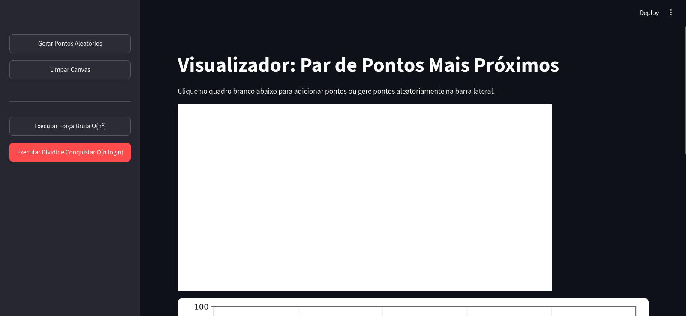
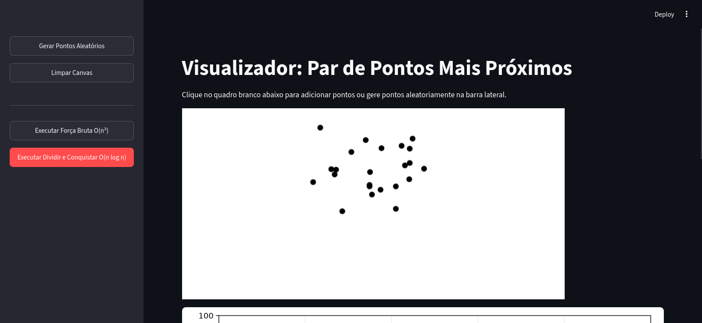
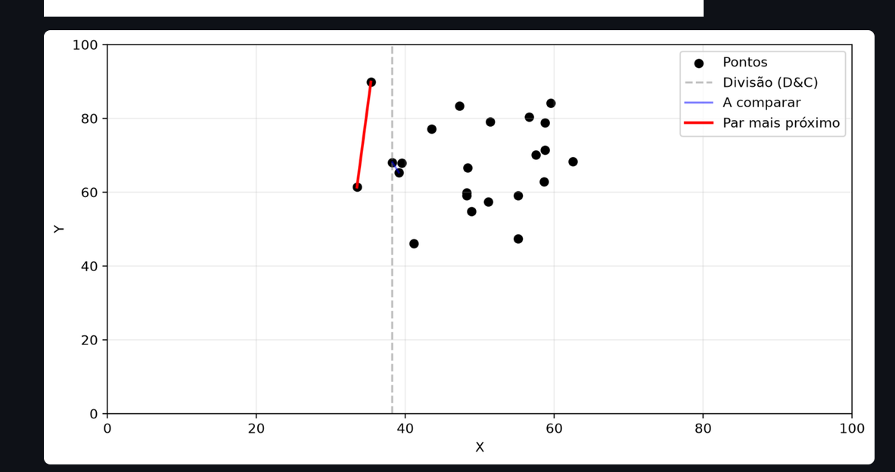
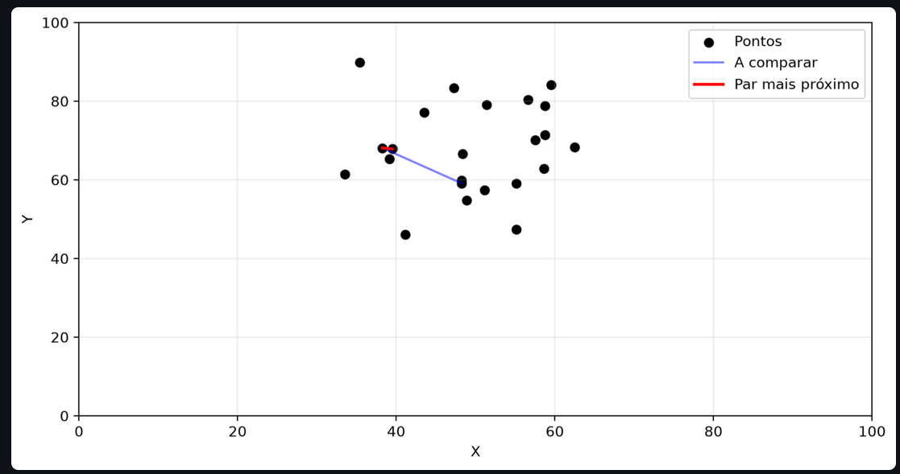
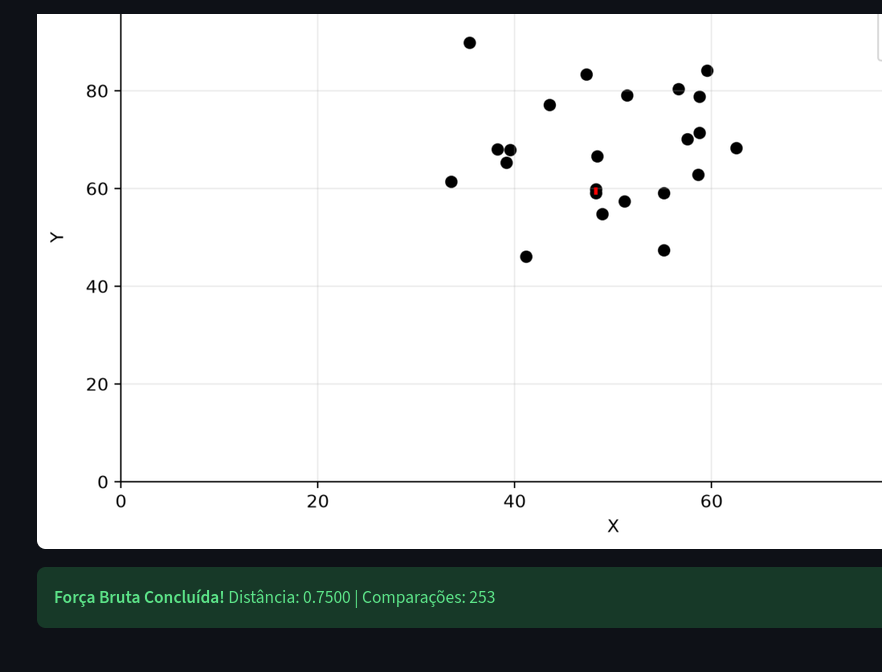
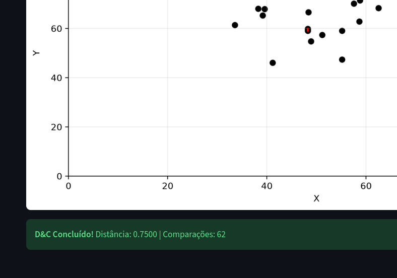

## Grupo 9 - 26.2 - Dividir e Conquistar
## Alunos
|Matrícula | Aluno |
| -- | -- |
| 232003652 | João Paulo Barbosa Pereira Nunes |
| 251023184 | João Pedro da Nóbrega Souza Cordeiro |
## Sobre
Este projeto apresenta um visualizador interativo para o problema do **par de pontos mais próximos**.
A aplicação permite adicionar pontos manualmente em um canvas ou gerar pontos aleatórios. Em seguida, é possível visualizar passo a passo a execução de dois algoritmos:
- **Força Bruta**, com complexidade `O(n²)`;
- **Dividir e Conquistar**, com complexidade `O(n log n)`.
Durante a execução, a aplicação destaca as comparações realizadas, as divisões do conjunto de pontos e o par de pontos mais próximo encontrado.
O objetivo é demonstrar visualmente a diferença entre uma abordagem tradicional e uma abordagem baseada na técnica de dividir e conquistar.
---
[Clique aqui para assistir ao vídeo de apresentação do projeto](https://youtu.be/Rfr-yE8ll9E)
## Screenshots






## Instalação
**Linguagem:** Python 3.10 ou superior
**Bibliotecas utilizadas:**
- Streamlit;
- Matplotlib;
- Streamlit Drawable Canvas.
As dependências estão disponíveis no arquivo `requirements.txt`.
### Como executar
#### 1. Clonar o repositório
```bash
git clone https://github.com/projeto-de-algoritmos-2026/G9_Dividir_e_Conquistar_PA_26.2.git
cd G9_Dividir_e_Conquistar_PA_26.2
```
#### 2. Criar o ambiente virtual
```bash
python3 -m venv .venv
```
No Linux ou macOS:
```bash
source .venv/bin/activate
```
No Windows:
```bash
.venv\Scripts\activate
```
#### 3. Instalar as dependências
```bash
pip install -r requirements.txt
```
#### 4. Executar a aplicação
```bash
streamlit run app.py
```
Após a execução, a aplicação estará disponível no navegador pelo endereço:
```text
http://localhost:8501
```
## Uso
1. Acesse a aplicação pelo navegador.
2. Adicione pontos clicando no canvas branco.
3. Utilize o botão **Gerar Pontos Aleatórios** para criar um conjunto automático de pontos.
4. Utilize o botão **Limpar Canvas** para remover os pontos desenhados.
5. Execute uma das opções disponíveis:
   - **Executar Força Bruta O(n²)**;
   - **Executar Dividir e Conquistar O(n log n)**.
6. Acompanhe graficamente as comparações realizadas pelos algoritmos.
7. Ao final da execução, observe a distância e o par de pontos mais próximos encontrados.
A aplicação exige pelo menos dois pontos para executar os algoritmos.
## Outros
### Funcionalidades
- Adição manual de pontos no canvas;
- Geração de pontos aleatórios;
- Limpeza do canvas;
- Visualização gráfica dos pontos;
- Animação das comparações entre pontos;
- Destaque do par de pontos mais próximo;
- Comparação entre os algoritmos de força bruta e dividir e conquistar;
- Exibição da distância mínima encontrada;
- Exibição da quantidade de comparações realizadas;
- Representação visual das linhas de divisão utilizadas pelo algoritmo de dividir e conquistar.
### Algoritmos utilizados
#### Força Bruta
O algoritmo compara todos os pares possíveis de pontos e mantém o par com a menor distância encontrada.
Sua complexidade de tempo é:
```text
O(n²)
```
#### Dividir e Conquistar
O algoritmo ordena os pontos pela coordenada `x`, divide o conjunto em duas partes, resolve cada parte recursivamente e verifica os pontos próximos à linha de divisão.
Sua complexidade média de tempo é:
```text
O(n log n)
```
### Estrutura do projeto
```text
G9_Dividir_e_Conquistar_PA_26.2/
├── algorithms.py        # Implementação dos algoritmos
├── app.py               # Interface gráfica e execução da aplicação
├── requirements.txt     # Dependências do projeto
├── static/              # Arquivos estáticos da aplicação
├── templates/           # Templates da aplicação
└── prints/              # Imagens da execução do projeto
```
### Tecnologias
- Python;
- Streamlit;
- Matplotlib;
- Streamlit Drawable Canvas;
- Git e GitHub.
